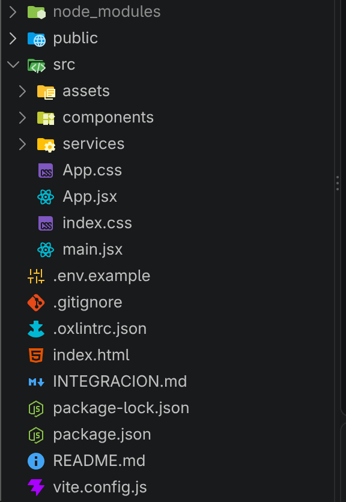

# Gestor de tareas con React

## Integrantes
- Mateo Miller
- Daniel Durán
- Jonnathan Saavedra
- Nicolás Cedillo

---

## Investigación sobre React

### Panorama

#### Origen
Fue creado en el año 2013 por Jordan Walke, quien trabajaba en Facebook. Su objetivo era crear interfaces de usuario dinámicas y reutilizables. 

#### Quien lo mantiene
Es mantenido por **React team** y por desarrolles de la comunidad de código abierto

#### Versión
Actualmente se encuentra en la versión 19 

#### Licencia
Tiene la MIT License y es de código abierto

#### Filosofía
Como biblioteca, se basa en estos principios:
1. Declarativa: describe como se ve la interfaz de acuerdo a datos
2. Componentes: piezas de código reutilizables
3. Unidireccional: datos van de componentes padres a hijos mediante propiedades
4. Basado en estados: la interfaz cambia cuando se alteran los datos


### Instalación

#### Creación del proyecto
Primero tenemos que tener instalado `npm` y `node`. Para luego ejecutar
```bash
npm create vite@latest nombre -- --template react
```

#### Estructura 

| Fichero | Función |
| :--- | :--- |
| `node-modules` | Dependencias y bibliotecas instaladas|
| `public` | Guarda archivos estáticos |
| `src` | Código fuente de la aplicación |
| `index.html`| HTML donde se ejecuta react |
| `package.json` | Información del proyecto |
| `vite.config.js` | Configuración de Vite |


### Componentes
Componentes, plantillas o JSX, props/inputs, eventos, renderizado condicional y listas, ciclo de vida

### Estado y reactividad
Reactividad (signals, hooks, refs), estado global (servicios, Context/Zustand, Pinia)

### Rutas y API
Enrutador, consumo de API REST con fetch o HttpClient, manejo de errores y carga

### Pruebas
Herramienta de pruebas (Jasmine/Karma, Vitest, Jest) y pruebas de componentes

### Ecosistema y despliegue
CLI, DevTools, librerías de UI, build de producción, despliegue (Netlify, Vercel, GitHub Pages)

---

## Métricas

| Métrica | Resultado |
| :--- | :--- |
| Tiempo de configuración inicial (min) | 5 min |
| Líneas de código de la app (LOC) | `npx cloc src` nos da  |
| Tamaño del build de producción (KB) | Carpeta `dist` tras el build |
| Puntaje de rendimiento Lighthouse | Chrome DevTools, modo móvil |

Horas totales del grupo:
- Mateo Miller:
- Jonnathan Saavedra
- Daniel Durán:
- Nicolás Cedillo:
---

## Uso de IA 

Cuaderno de NotebookLM: [link](https://notebook.google.com/notebook/20b92080-224d-46a7-b0bc-4e0a6c3e1ae9)

### Declaración de uso

Usamos esta IA para ...
