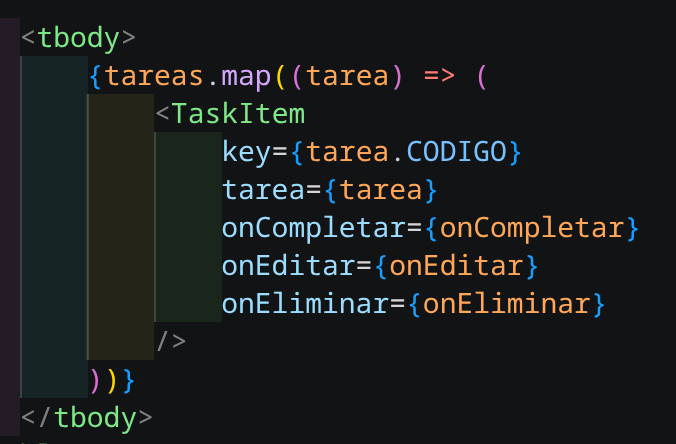
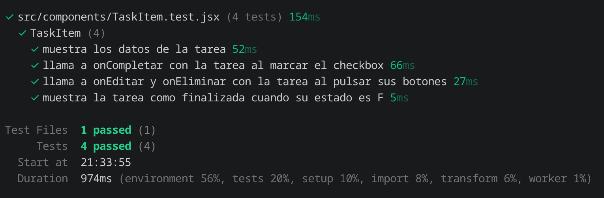
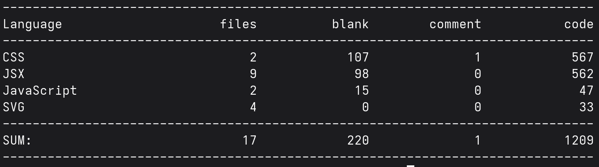

# Gestor de tareas con React

## Integrantes
- Mateo Miller
- Daniel Durán
- Jonnathan Saavedra
- Nicolás Cedillo

**Entregar las tareas en el AVAC:** Nicolás Cedillo

**Framework asignado:** React con paginación

**URL pública:**

**Repositorio:** https://github.com/MJMMiller/GestionDeTareas/tree/main

---

## Cómo ejecutar el proyecto


```bash
npm install          # instala dependencias
npm run dev          # servidor de desarrollo 
npm run test         # pruebas unitarias

```

---

## Investigación sobre React


### Panorama

#### Ficha técnica

| Campo | Dato |
| :--- | :--- |
| Nombre | React  |
| Creador | Jordan Walke (Facebook) |
| Lanzamiento público | 29 de mayo de 2013 |
| Tipo | Biblioteca de JavaScript para interfaces de usuario |
| Versión actual | 19.3.1|
| Licencia | MIT License |
| Repositorio oficial | https://github.com/facebook/react |
| Documentación oficial | https://react.dev |

#### Origen
Fue creado en el año 2013 por Jordan Walke, quien trabajaba en Facebook. Su objetivo era crear interfaces de usuario dinámicas y reutilizables. 


#### Filosofía
Como biblioteca, se basa en estos principios:
1. Declarativa: describe como se ve la interfaz de acuerdo a datos
2. Componentes: piezas de código reutilizables
3. Unidireccional: datos van de componentes padres a hijos mediante propiedades
4. Basado en estados: la interfaz cambia cuando se alteran los datos

React es una **librería**, no un framework completo: solo resuelve la capa de vista. Por eso el enrutamiento (React Router), las peticiones HTTP y el estado global se resuelven con herramientas adicionales.


### Instalación

#### Creación del proyecto
Primero tenemos que tener instalado `npm` y `node`. Para luego ejecutar
```bash
npm create vite@latest nombre -- --template react
```

#### Estructura 

| Fichero | Función |
| :--- | :--- |
| `node_modules` | Dependencias y bibliotecas instaladas|
| `public` | Guarda archivos estáticos |
| `src` | Código fuente de la aplicación |
| `index.html`| HTML donde se ejecuta react |
| `package.json` | Información del proyecto |
| `vite.config.js` | Configuración de Vite |

#### Hola mundo explicado línea por línea

```jsx
// src/main.jsx
import { StrictMode } from 'react'              
import { createRoot } from 'react-dom/client'    
import App from './App.jsx'                    

createRoot(document.getElementById('root')).render(  
  <StrictMode>                                        
    <App />                                          
  </StrictMode>                                  
)
```

| Línea | Explicación |
| :--- | :--- |
| 1 | Importa `StrictMode`, que activa avisos adicionales en desarrollo. |
| 2 | Importa `createRoot`, que conecta React con el DOM del navegador. |
| 3 | Importa el componente principal de la aplicación. |
| 4 | Busca el `<div id="root">` de `index.html` y le indica a React que dibuje ahí. |
| 5-7 | Renderiza `<App />` dentro de `StrictMode`. |

```jsx
// src/App.jsx
function App() {
  return <p>Hola mundo</p>
}

export default App
```

`App` es un componente: una función que devuelve JSX. `export default` permite importarla desde `main.jsx`.

**Error encontrado y solución:** se cambio el número de puerto, siempre se usa el `3001` para evitar errores que el puerto esté ocupado.

### Componentes

- Los **componentes** permiten dividir una interfaz de usuario en partes independientes y reutilizables. 

- **JSX** (JavaScript XML) es una extensión de JavaScript que permite escribir estructuras similares a HTML dentro del código JavaScript.

- Las **props** son datos que un componente recibe desde su componente padre. Permiten reutilizar componentes enviándoles información diferente.

- Se permite responder a las interacciones del usuario mediante manejadores de **eventos**.

- El **renderizado condicional** permite mostrar diferentes elementos de la interfaz dependiendo de una condición.

- React permite representar **listas** de elementos utilizando métodos de JavaScript como `map()`

- Los componentes tienen un **ciclo de vida** que describe las diferentes etapas por las que pasan durante su funcionamiento.

#### Ejemplo propio: componente reutilizable usado 3 veces con datos distintos


```jsx
// src/components/TaskItem.jsx
function TaskItem({ tarea, onCompletar, onEditar, onEliminar }) {

    return (
        /* Revisar codigo en el repositorio*/
    );
}
```

Uso con 3 datos distintos:


#### Ciclo de vida con `useEffect`

Un componente aparece, se actualiza y desaparece. En componentes funcionales, `useEffect` permite ejecutar código en esas etapas:

```jsx
useEffect(() => {
  obtenerTareas()          // se ejecuta al montar el componente
}, [])                     // el arreglo vacío significa "solo una vez"
```


### Estado y reactividad
La **reactividad** es la capacidad de React para actualizar la interfaz cuando cambian los datos que utiliza un componente.

#### Hooks
Son funciones especiales de React que permiten utilizar características como el estado, los efectos secundarios y el contexto dentro de componentes funcionales.Por ejemplo: 
- `useState`:Permite almacenar y actualizar el estado de un componente.
- `useEffect`:Permite ejecutar efectos secundarios.
- `useContext`:Permite acceder a información compartida mediante Context.
- `useRef`:Permite conservar referencias a elementos y valores entre renderizados.
- `useReducer`:Permite administrar estados mediante una función reductora.
- `useMemo`:Permite memorizar resultados de cálculos.
- `useCallback`:Permite memorizar funciones.

#### Estado global
Cuando varios componentes necesitan los mismos datos, se evita pasarlos por muchas capas de props y se usa estado global. Opciones: **Context API** (incluida en React) o librerías como **Zustand**.

**FALTA**


### Rutas y API
El **enrutamiento** permite navegar entre diferentes páginas o vistas de una aplicación sin tener que recargar completamente el documento HTML.

React puede comunicarse con servidores externos para obtener, enviar, modificar o eliminar información. Para esto usamos `fetch()`

#### Consumo de API 

```jsx
export async function listarTareas() {
    const response = await fetch(`${API_URL}/tareas`);

    if (!response.ok) {
        throw new Error("Error al cargar las tareas");
    }

    return response.json();
}
```

### Pruebas
Las pruebas permiten comprobar que los componentes y funcionalidades de una aplicación funcionan correctamente.

Herramientas de pruebas
|Herramienta| Función|
|----|---|
|Vitest	|Ejecuta pruebas unitarias y de integración.|
|Jest|Permite realizar pruebas automatizadas de JavaScript y React.|
|React Testing Library|Facilita las pruebas de componentes desde la perspectiva del usuario.|

#### Herramientas que usamos en la app

Elegimos **Vitest** porque se integra directamente con Vite, que es la herramienta con la que creamos el proyecto.

| Librería | Para qué la usamos |
| :--- | :--- |
| Vitest | Ejecuta las pruebas (`describe`, `it`, `expect`) |
| jsdom | Simula un navegador dentro de Node, para que React tenga dónde dibujar los componentes |
| React Testing Library | Dibuja el componente (`render`) y busca elementos como los vería un usuario (`screen`) |
| user-event | Simula clics reales del usuario |

#### Instalación y configuración

```bash
npm install -D vitest jsdom @testing-library/react @testing-library/jest-dom @testing-library/user-event
```

En `vite.config.js` se agregó el bloque `test`:

```js
test: {
  environment: 'jsdom',
  globals: true,
  setupFiles: './src/test/setup.js'
}
```

En `src/test/setup.js` se importa jest-dom para habilitar las verificaciones adicionales:

```js
import '@testing-library/jest-dom/vitest'
```

Y en `package.json` se agregó el script `"test:run": "vitest run"`, que ejecuta todas las pruebas una sola vez.

#### Pruebas del componente `TaskItem`

Las pruebas están en `TaskItem.test.jsx`, junto al componente. Todas siguen tres pasos: preparar (dibujar el componente con una tarea de ejemplo), actuar (simular un clic) y verificar (comprobar el resultado esperado).

| # | Prueba | Qué comprueba | Concepto de React |
| :-: | :--- | :--- | :--- |
| 1 | Muestra los datos de la tarea | Que se vean el título, el estado traducido ("P" → "Sin empezar"), la materia y la prioridad | Props y renderizado |
| 2 | Llama a `onCompletar` al marcar el checkbox | Que al hacer clic se invoque la función con la tarea correcta | Eventos |
| 3 | Llama a `onEditar` y `onEliminar` al pulsar sus botones | Que cada botón invoque su función con la tarea correcta | Eventos |
| 4 | Muestra la tarea como finalizada cuando el estado es `F` | Que diga "Finalizada" y que el checkbox esté marcado | Renderizado condicional |

#### Resultado de las pruebas

Se ejecutaron con:

```bash
npm run test:run
```



### Ecosistema y despliegue
React no proporciona una CLI oficial para generar proyectos y administrar toda su estructura.

Para crear proyectos se utilizan herramientas externas como **Vite**. También se pueden utilizar otras herramientas compatibles con React.

- *React*: biblioteca para construir interfaces.
- *Vite*: herramienta de desarrollo y construcción.
- *npm*: administrador de paquetes.

#### Herramientas del ecosistema

| Herramienta | Uso |
| :--- | :--- |
| React Developer Tools | Extensión del navegador para inspeccionar componentes, props y estado |
| React Router | Enrutamiento |
| Vitest + Testing Library | Pruebas |
| CSS propio | Estilos y diseño responsive |

🔴 **FALTA:** captura de React DevTools mostrando el árbol de componentes de la app.

#### Build de producción

```bash
npm run build     # genera la carpeta dist
npm run preview   # prueba local del build
```

---

## Métricas

| Métrica | Resultado |
| :--- | :--- |
| Tiempo de configuración inicial (min) | added 149 packages, and audited 150 packages in 22s|
| Líneas de código de la app |   |
| Tamaño del build de producción (KB) | 288 dist |
| Puntaje de rendimiento Lighthouse | Chrome DevTools, modo móvil |

Horas totales del grupo junto con dificultad percibida (de 1 a 5):
- Mateo Miller: 
- Jonnathan Saavedra: 
- Daniel Durán: 
- Nicolás Cedillo: 

---

## Documentación técnica

- [Guía de instalación y conexión React–Oracle](docs/GUIA_INSTALACION_Y_CONEXION.md)

---

## Fuentes

Documentación oficial usada para verificar la información:
- React: https://react.dev/learn
- React, referencia de la API: https://react.dev/reference/react
- Vite: https://vite.dev/guide
- Vite, despliegue estático: https://vite.dev/guide/static-deploy
- React Router: https://reactrouter.com/docs
- Vitest: https://vitest.dev/guide/browser/component-testing
- React Testing Library: https://testing-library.com/docs/react-testing-library/intro
- JSON Server: https://github.com/typicode/json-server
- Lighthouse: https://developer.chrome.com/docs/lighthouse/overview

---

## Uso de IA 

Cuaderno de NotebookLM: [dar click aquí para abrir el link](https://notebook.google.com/notebook/20b92080-224d-46a7-b0bc-4e0a6c3e1ae9)


### Declaración de uso

Usamos Claude y Gemini para aprender de la librería y sus conceptos fundamentales. En Gemini creamos un mapa mental con ideas base de React para luego pedir guía tanto a Gemini como a Claude. Además, nos apoyamos en estas herramientas para entender errores que se nos presentaban en el codigo ya sea por sintaxis o mal uso de alguna herramienta. 

### Ejemplos reales de lo que preguntamos

1. **Pregunta:** Qué son los componentes en React y cuál es su función?"
    
    **Dónde se implementó:**
    ```js 
    function TaskItem({ tarea, onCompletar, onEditar, onEliminar }) {

        return...}
    ```
2. **Pregunta:** Qué es JSX en React y para qué sirve? Dame un ejemplo sencillo.
    
    **Dónde se implementó:**
    ```js 
    return (
    <>
      <header>
        
        <h1>Gestor</h1>
        <p>Tareas Universitarias</p>
        <button type="button" onClick={abrirNueva}>
          Añadir tarea
        </button>
      </header>
    ```
3. **Pregunta:** Qué son las props en React y cómo se utilizan para pasar información
    
    **Dónde se implementó:**
    ```js 
    function TaskItem({ tarea, onCompletar, onEditar, onEliminar }) {}
    ```
4. **Pregunta:** Qué es el estado en React y cómo funciona el hook useState? Explica con un ejemplo básico
    
    **Dónde se implementó:**
    ```js 
    import { useState, useEffect } from "react";
    const [materias, setMaterias] = useState([]);
    ```

---

